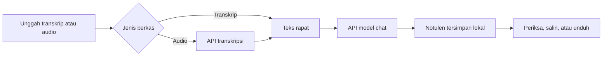

# Mom Taker

**Notulen rapat berbahasa Indonesia dari rekaman atau transkrip.** Unggah berkas, baca hasilnya, lalu unduh notulen dalam format Markdown jika sudah siap dibagikan.

Mom Taker berjalan di komputer Anda dengan antarmuka React dan backend FastAPI. Model chat dan transkripsi diakses lewat API yang kompatibel dengan OpenAI, sehingga alamat API dan nama model dapat diganti melalui `.env`.

## Yang bisa dilakukan

- Mengunggah transkrip `.txt` atau `.md` dalam UTF-8, atau audio `.mp3`, `.m4a`, `.wav`, `.webm`, `.mp4`, `.mpeg`, dan `.mpga` hingga 50 MB.
- Membuat ringkasan, poin penting, keputusan, dan tindak lanjut dari isi rapat.
- Membuka kembali notulen dan transkrip sumber, menyalin notulen, atau mengunduhnya sebagai `.md`.
- Menyimpan notulen dan transkrip di folder `data/` pada komputer yang menjalankan aplikasi. Berkas audio asli tidak disimpan.

## Cara kerja



Model diminta menulis dalam Bahasa Indonesia berdasarkan transkrip. Informasi yang tidak disebutkan, seperti penanggung jawab atau tenggat, tidak boleh ditebak. Tetap periksa hasilnya sebelum dibagikan.

## Menjalankan di Windows

Siapkan Python 3.10 atau lebih baru dan Node.js 22.12 atau lebih baru. Jalankan perintah berikut dari PowerShell di folder proyek.

```powershell
py -m venv .venv
.\.venv\Scripts\python.exe -m pip install -r requirements.txt
Copy-Item .env.example .env
```

Isi `.env` sesuai provider yang akan digunakan. Setelah itu, bangun frontend dan jalankan server:

```powershell
Set-Location frontend
npm ci
npm run build
Set-Location ..
.\.venv\Scripts\uvicorn.exe app:app --host 127.0.0.1 --port 8000
```

Buka **http://127.0.0.1:8000**. Proses pertama memerlukan instalasi paket Python dan Node dari internet.

## Konfigurasi model

| Variabel | Isi |
| --- | --- |
| `OPENAI_API_KEY` | API key dari provider. |
| `OPENAI_BASE_URL` | Base URL API, misalnya `https://api.openai.com/v1`. |
| `OPENAI_MODEL` | Nama model untuk membuat notulen melalui `/chat/completions`. |
| `OPENAI_TRANSCRIPTION_MODEL` | Nama model untuk audio melalui `/audio/transcriptions`. Tidak dipakai saat mengunggah berkas teks. |

Provider perlu menyediakan endpoint yang sesuai dengan jenis berkas yang Anda gunakan. File `.env` sudah masuk `.gitignore`; jangan masukkan API key ke commit.

## Mengubah frontend

Jalankan backend seperti biasa. Di terminal kedua, masuk ke `frontend` dan jalankan `npm run dev`. Buka alamat yang ditampilkan Vite. Permintaan `/api` dari frontend akan diteruskan ke FastAPI di port 8000.

## Struktur proyek

```text
mom-taker/
├── app.py                 # API, transkripsi, pembuatan notulen, penyimpanan
├── frontend/              # Antarmuka React dan Vite
├── requirements.txt       # Paket Python
├── .env.example           # Contoh konfigurasi model
└── data/                  # Notulen lokal; dibuat otomatis, tidak masuk Git
```

## Batas versi saat ini

Aplikasi ini ditujukan untuk penggunaan lokal di `127.0.0.1`. Belum ada akun pengguna, kontrol akses, atau bot yang bergabung ke rapat. Pembagian hasil dilakukan dengan menyalin notulen atau mengunduh file Markdown.
